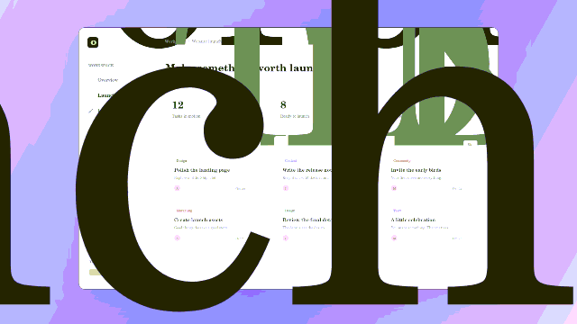

# ▶ RepoReel

**앱 화면을 한 번 녹화해서 GitHub README GIF, 발표 영상, 커버 이미지로.**

[**샘플 GIF 바로 만들어 보기**](https://junghwan0516.github.io/reporeel/?start=gif) · [스튜디오 열기](https://junghwan0516.github.io/reporeel/) · [English](README.md)

가입, 영상 업로드, 워터마크 없이 브라우저에서 편집할 수 있어요. 처음에는 확장 프로그램도 필요 없어요.



*기본 제공되는 Orbit 일러스트 샘플입니다. 실제 외부 앱을 녹화한 영상은 아닙니다.*

## 60초 체험: 아무것도 녹화하지 않고 GIF 만들기

1. [샘플 GIF 바로 만들어 보기](https://junghwan0516.github.io/reporeel/?start=gif)를 눌러요.
2. **Export README GIF**를 누르면 샘플 영상이 `demo.gif`로 저장돼요.
3. 내보내기 창을 닫고 샘플을 재생해요. 원하는 장면에 멈춘 뒤 **Before / after**를 누르면 같은 장면의 원본과 편집본을 비교할 수 있어요. **Save comparison PNG**로 비교 이미지를 저장할 수도 있어요.

## 내 앱으로 첫 데모 만들기

| 순서 | 화면에서 할 일 |
|---|---|
| **1. 가져오기** | **Bring your own video**로 MP4·WebM을 열거나 **Record screen**에서 내 앱 탭을 선택해요. |
| **2. 편집하기** | 용도에 따라 **Pitch deck**, **README**, **Square social** 프리셋을 골라요. 중요한 장면에 멈추고 **Add focus**를 눌러 강조할 부분을 클릭해요. **Captions**에서 짧은 설명을 붙여요. |
| **3. 확인하기** | 민감한 정보가 보이면 **Redactions**에서 가릴 영역을 정해요. **Before / after**에서 가림 처리를 유지한 채 원본과 편집본을 비교해요. 공유 전에 영상 전체도 확인해요. |
| **4. 내보내기** | **Export → README GIF**로 GIF를 만들어요. 브라우저 GIF 출력은 최대 20초예요. 발표용은 **Video**(무음 WebM), 대표 이미지는 **Cover image**(PNG)를 골라요. |
| **5. 올리기** | 내 프로젝트 저장소의 `docs/demo.gif`에 GIF를 올려요. **Copy Markdown**을 누르고 README에 붙여넣어요. |

```md

```

## 클릭을 자동으로 기록하려면

일반 화면 녹화는 앱 탭의 클릭 위치를 수집하지 않아요. 직접 **Add focus**를 사용하거나 [Chrome 확장 ZIP](https://junghwan0516.github.io/reporeel/downloads/reporeel-extension.zip)을 풀고 `chrome://extensions` → **개발자 모드** → **압축해제된 확장 프로그램 로드**에서 설치하세요. 내 앱 탭에서 확장 아이콘을 누르면 녹화를 시작할 수 있어요.

확장은 수동 설치용 베타이며 Chrome 웹 스토어 배포본은 아니에요. 전체 페이지를 이동하거나 새로고침하면 그 문서의 클릭 추적이 이어지지 않아요. 이후 장면에는 확대 지점을 직접 추가하세요.

**공유할 때는 완성 영상 또는 이미지만 올려요.** 편집 프로젝트(`.reel.json`)에는 가림 처리 전 원본이 포함돼요. 영상 입력은 최대 80 MB·10분이며 지원 코덱은 브라우저에 따라 달라요. 로컬 실행·테스트·세부 제한은 [영문 README](README.md)에서 볼 수 있어요.

[데모 공유하기](https://github.com/Junghwan0516/reporeel/issues/new?template=demo-showcase.md)에서 완성본을 소개할 수 있어요. RepoReel로 만든 데모가 있다면 완성 영상과 함께 스튜디오 링크를 공유해 주세요. 유용했다면 GitHub 스타도 다른 개발자가 프로젝트를 발견하는 데 도움이 돼요.
