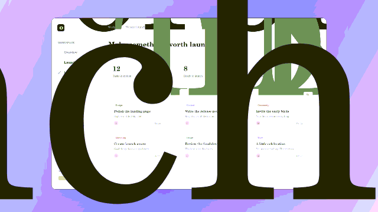

<div align="center">

# ▶ RepoReel

### Record your app. Make it a launch.

**Turn one app walkthrough into a pitch-deck clip, a README GIF, and a cover image.**

[**Try the sample GIF →**](https://junghwan0516.github.io/reporeel/?start=gif) · [Open the studio](https://junghwan0516.github.io/reporeel/) · [Capture extension](https://junghwan0516.github.io/reporeel/downloads/reporeel-extension.zip) · [한국어](README.ko.md)

Local processing · No account · No API keys · No watermark · MIT


</div>



*The illustrated Orbit sample, rendered with the same camera, cursor, caption, and export pipeline as your footage. It is not a recording of a third-party app.*

You built something good. Give people a reason to look closer.

RepoReel turns a clip of your app into a polished demo: click-focused camera motion, a smooth cursor, captions, opaque redactions, a gradient canvas, and a GIF you can put straight into your README. Everything runs on your device.

## Try it in 60 seconds

1. [Open the sample GIF exporter](https://junghwan0516.github.io/reporeel/?start=gif) and click **Export README GIF**. You get a real file without recording or uploading anything.
2. Close the export window, play the sample, then pause on a click and choose **Before / after** to compare the same source and edited frame. Save a comparison PNG if useful.
3. Switch among **Pitch deck**, **README**, and **Square social** to try different framing. Then record or import your app and export a clip.

## Make your own demo

**[Open the studio](https://junghwan0516.github.io/reporeel/)**, press play, and change the background or canvas ratio. Export the sample as a GIF, silent WebM, or PNG cover.

To use your own app:

1. Drop in an MP4/WebM clip, or choose **Record screen** and select a screen, window, or tab in your browser's picker.
2. Scrub to a moment, choose **Add focus**, and click the part of the frame you want to highlight.
3. Add captions. Draw opaque redactions over anything private.
4. Trim to 20 seconds or less for GIF. Choose **Export → README GIF → Export README GIF** and upload `demo.gif` to `docs/demo.gif` in your own repository. Use **Copy Markdown** to embed it. **Save project** keeps your original footage and edits in one `.reel.json` file.

Want automatic click tracking? Use the optional capture extension below.

## Capture the clicks, too

The Chrome extension records a regular app tab plus pointer positions and clicks. Stop capture and the editor opens locally with those events ready for automatic zoom.

1. [Download the extension ZIP](https://junghwan0516.github.io/reporeel/downloads/reporeel-extension.zip) and extract it.
2. Open `chrome://extensions`, enable **Developer mode**, and choose **Load unpacked**.
3. Select the extracted directory containing `manifest.json`.
4. Open your app and click the RepoReel toolbar icon. Choose **Start recording this tab**.
5. Perform your demo. Open the icon again and choose **Stop & open studio**.

Chrome 116 or later. This is an unpacked source extension, not a Chrome Web Store listing. Capture is silent and starts only after your explicit action. Pointer capture is limited to the top-level document: cross-origin frames are not tracked, and a full page navigation/reload ends pointer tracking in that document. Video capture can continue; add manual focus points after such a navigation.

The extension is an optional beta. Its state and packaging checks run in CI; browser-editor export paths have been exercised separately. End-to-end extension capture still needs validation in a supported desktop Chrome session.

## What ships in v0.1

| Feature | Behavior |
| --- | --- |
| Canvas | 16:9, 1:1, 9:16; five gradients; padding; rounded frame; shadow |
| Camera | Smooth click/focus zoom with edge-clamped framing |
| Cursor | Timestamped pointer interpolation and click rings; capture or add events |
| Captions | Editable text, start and end times, burned into exports |
| Redactions | Opaque source-relative rectangles applied throughout the clip |
| Timeline | Scrubbing, focus markers, caption blocks, trim, speed, undo |
| Capture | Native browser screen picker; optional Chrome tab-and-pointer extension |
| Export | Silent WebM, looping GIF with GIF LZW compression, PNG cover |
| Portability | Embedded source video and editable tracks in `.reel.json` |
| Local conversion | Python helper invokes your installed FFmpeg for MP4 or an optimized GIF |

The imported-video thumbnail strip uses the current frame as a visual placeholder. It does not scan or index every scene.

## A GIF for your README

Choose **Export → README GIF**. Drop the result into `docs/demo.gif` and copy the generated Markdown:

```md

```

Use a short, focused clip. Browser GIF exports are 480px on the long edge, 10 fps, and limited to 20 seconds of output. The fixed palette keeps the encoder local and small; gradients may show banding. File size varies with movement and detail.

Video exports use a 1280×720 canvas for 16:9, 1280×1280 for square, or 720×1280 for portrait. They render in real time and require the tab to stay visible. The exporter stops if the tab is hidden, instead of silently claiming a complete video.

## Need MP4?

Export a WebM in the studio, then run:

```sh
python3 tools/convert.py demo.webm --mp4 demo.mp4
```

Or create a 640px GIF using FFmpeg's palette optimization:

```sh
python3 tools/convert.py demo.webm --gif demo.gif --width 640
```

Python 3.10+ and an installed `ffmpeg` executable are required for conversion. No pip packages. Existing output files are never overwritten. FFmpeg must include the encoder required by the selected output.

## Run locally

```sh
python3 dev.py
# Open http://127.0.0.1:8080
```

The studio has no build step, runtime npm packages, external fonts, analytics, or backend. Node.js 18+ is only needed for development tests. Python is only needed for a local static server, packaging, or optional conversion; the hosted studio works without Python.

Build the downloadable extension from source:

```sh
python3 tools/build.py
# web/downloads/reporeel-extension.zip
```

The ZIP includes a copy of the studio. The extension does not rely on the hosted website to edit or export a capture.

## What stays private

- Imported footage and edits are held in browser memory until you save or export.
- The capture extension keeps the latest capture in its local IndexedDB; a new successful capture replaces it. You can remove that stored capture from the extension's storage or by uninstalling the extension.
- No video, pointer events, or project files are uploaded by the application. Opening the hosted studio loads its static files from GitHub Pages.
- Saved projects contain the **original unredacted video**. Redactions affect the rendered exports, not the embedded source. Share finished exports rather than source projects when the original contains private information.
- The extension records pointer coordinates and clicks, not keystrokes, page text, or DOM snapshots. The video itself can still contain anything visible on the captured tab.

## Scope and limits

This is a focused first release, not a full nonlinear video editor.

- Inputs: at most **80 MB** and **10 minutes**; supported codecs depend on the browser. H.264 MP4 and WebM are the recommended formats. MOV is codec-dependent.
- Output is **silent**. Audio, narration, automatic pause removal, and generated click scripts are not included.
- Native browser screen recording does not collect pointer metadata from another tab. Use manual focus points or the extension for automatic click zoom.
- There is no automatic secret detector. Redaction is manual; review the entire exported file before sharing.
- A capture contains the original browser cursor if the browser includes it. The overlay cursor can be disabled to avoid double cursors.
- GIF encoding runs on the main thread with short yields. Large or long projects can use substantial memory.
- The studio is primarily designed for current desktop Chromium. Mobile editors can import supported videos, but capture and video encoding capabilities vary. The extension is desktop Chrome-only.
- Saved projects may be substantially larger than their source videos because the source is embedded as base64. Project files are not encrypted.

## Tests

```sh
node --test tests/*.test.cjs
python3 -m pip install Pillow  # test-only dependency
python3 -m unittest discover -s tests -p 'test_*.py'
```

Tests check camera bounds, pointer interpolation, trim/speed duration, project input validation, GIF frame structure and decoded pixel values across dictionary resets, extension packaging, and conversion path validation. CI also checks JavaScript syntax.

The renderer is shared between preview, browser exports, and the optional sample-asset generator. To regenerate the README illustration, install `@napi-rs/canvas` in a development checkout and run `node tools/render-sample.cjs`. It is not required by the studio.

## Built to be small enough to understand

```
web/core.js         Project validation and animation math
web/renderer.js     Shared canvas renderer and illustrated sample
web/gif.js          Dependency-free GIF89a/LZW encoder
web/app.js          Editor, capture, project files, browser exports
extension/          MV3 active-tab capture and pointer tracking
tools/build.py      Extension ZIP builder
tools/convert.py    Local FFmpeg conversion helper
tests/              Model, encoder, packaging, and conversion checks
```

## Contributing

Focused improvements welcome. See [CONTRIBUTING.md](CONTRIBUTING.md). Current priorities: end-to-end capture tests, better imported-video thumbnails, worker-based GIF encoding, and audio export. These are future work, not current capabilities.

## License

[MIT](LICENSE).

[Share a finished demo](https://github.com/Junghwan0516/reporeel/issues/new?template=demo-showcase.md) in the showcase. If you shipped a demo with RepoReel, share the finished clip with a link to the studio so others can try it. A star helps more developers find the project.
